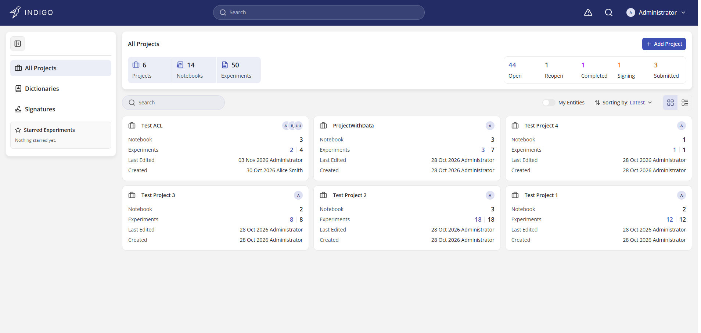
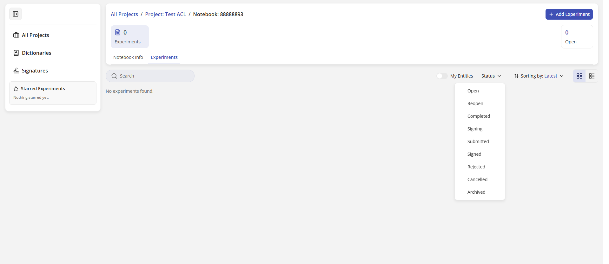
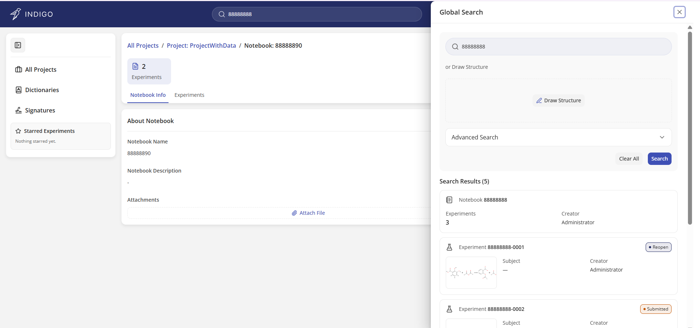
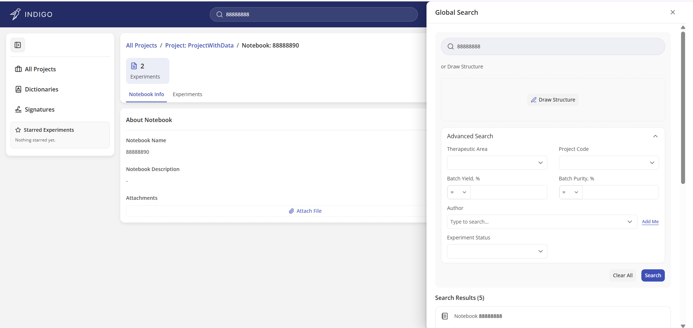

# Getting Started

This chapter shows you how to log in and find your way around Indigo ELN: the Dashboard, the left navigation menu, the breadcrumbs and Global Search.

## Before you start

- You need an Indigo ELN account. You only see the Projects, Notebooks and Experiments where you are a team member (see [Permissions and Team Management](07-access-and-permissions.md)).
- Work is organized in three levels: **Project** > **Notebook** > **Experiment**. See [Projects, Notebooks and Experiments](02-projects-notebooks-experiments.md).

## How to log in

1. Open the Indigo ELN login page.
2. Enter your username and password. Click the **View Password** icon if you want to see what you typed.
3. Optionally, check **Remember Me** to stay signed in on this computer.
4. Click **Log in**.

You land on the Dashboard. If the credentials are not recognized, you see "Failed to sign in. Please check your credentials and try again."

## The Dashboard

The **Dashboard** (**All Projects**) is your home page. It lists the Projects where you are a member.

- **Summary at the top:** how many Projects, Notebooks and Experiments you belong to, and how many Experiments are **Open**, **Reopen**, **Completed**, **Signing** or **Submitted**.
- **Project cards:** name, number of Notebooks and Experiments, who last edited and created the Project, and the Project members.
- **Search:** type text in the search field above the list to find items by text.
- **My Entities:** switch on to show only items you created.
- **Sorting by:** sort the list, for example by **Latest**.
- **Card view / list view:** the two icons at the right switch the layout. Card view is the default.

The same layout is used one level down: the **Notebooks** tab of a Project and the **Experiments** tab of a Notebook.

## The left navigation menu

- **All Projects** - opens the Dashboard.
- **Dictionaries** - opens the Dictionaries page (see [Administration](08-administration.md)).
- **Signatures** - opens the list of Experiments sent for signing (see [Projects, Notebooks and Experiments](02-projects-notebooks-experiments.md)).
- **Starred Experiments** - your personal shortcuts to Experiments you starred.

### How to star an Experiment

1. Open a Notebook and go to its **Experiments** tab.
2. Click the star icon on the Experiment.

The Experiment now appears under **Starred Experiments**. Stars are personal; other users do not see them.

### How to filter Experiments by status

1. Open a Notebook and go to its **Experiments** tab.
2. Open the **Status** dropdown and choose a status: **Open**, **Reopen**, **Completed**, **Signing**, **Submitted**, **Signed**, **Rejected**, **Cancelled** or **Archived**.

The list shows only Experiments with that status.

## Breadcrumbs

The breadcrumb bar at the top of each page shows where you are, for example **All Projects** / **Project: ProjectWithData** / **Notebook: 88888890**. Click any name in it to go back up to that level.

> **Not yet available:** the drop-down lists in the breadcrumbs for jumping to another Project, Notebook or Experiment.

## Global Search

Global Search finds Projects, Notebooks and Experiments by text, author, batch results or chemical structure.

### How to search

1. Click the search icon in the top-right corner of the page.
2. Enter a keyword, project code, compound ID or structure ID in the search bar, or draw a structure in the structure editor.
3. For a structure search, tick the roles to look in: **Reactant**, **Reagent**, **Solvent**, **Intended Product**, **Batch**.
4. Click **Search**.

A structure search finds Experiments that contain your structure as a substructure in the selected roles. If the input is not valid, you see "Invalid input. Check your search term or structure and try again."

### How to narrow the search

1. Open the **Advanced Search** dropdown.
2. Set any combination of filters:
   - **Therapeutic Area**, **Project Code**
   - **Batch Yield, %**, **Batch Purity, %** - a value with `<`, `=` or `>`, or a range
   - **Author** - type to search, or click **Add Me** to enter your own name
   - **Experiment Status**
3. Click **Search**.

Click **Clear All** to reset the search and all filters.

> Tip: A text search or an **Author** filter searches Projects, Notebooks and Experiments. A structure, **Batch Yield, %**, **Batch Purity, %** or **Experiment Status** searches Notebooks and Experiments only.

### How to read the results

Results appear in a paged list. Each row shows the type (Project, Notebook or Experiment), the name or ID and the creator. Experiments also show the reaction scheme, status, matched role, title and description. Click an Experiment's ID or title to open it. If nothing matches, you see "No results found".
