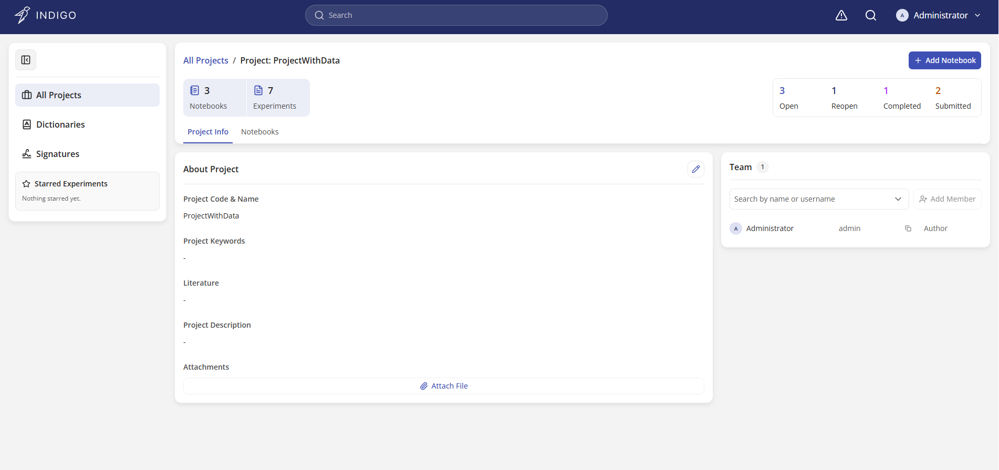
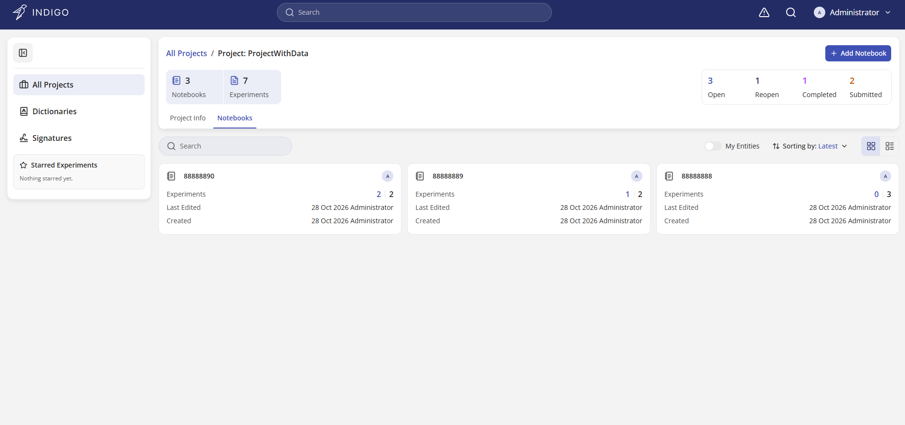
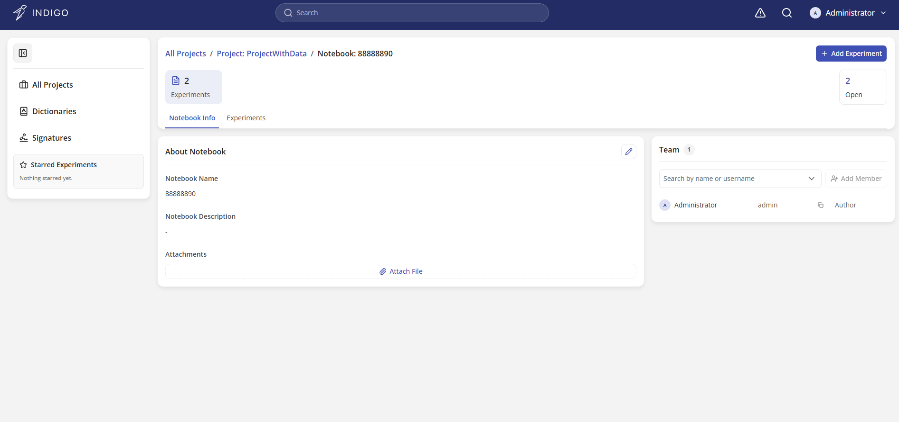
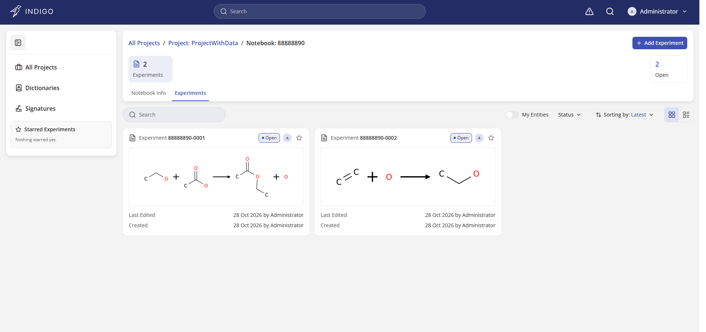
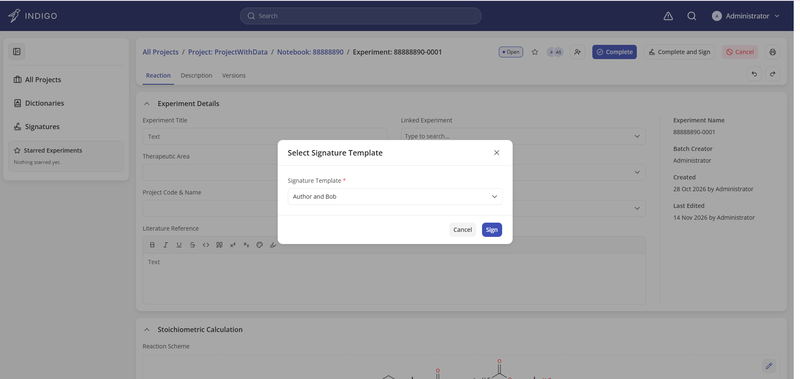
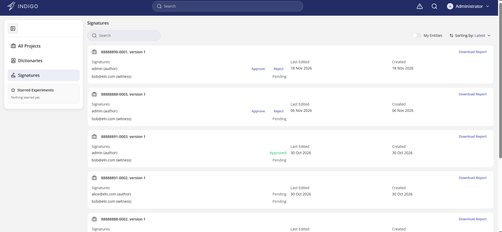

# Projects, Notebooks and Experiments

Work in Indigo ELN is organized in three levels:

- **Project** - the top level, for example a research programme.
- **Notebook** - belongs to a Project and groups related Experiments.
- **Experiment** - belongs to a Notebook. This is where you record the reaction and the results.

This chapter explains how to create and edit each level. For the contents of an Experiment, see [Working in an Experiment](03-working-in-an-experiment.md).

## Before you start

- You can open only the items where you are a team member. See [Getting Started](01-getting-started.md) for how to find them.
- What you can do depends on your permission on the item. See [Permissions and Team Management](07-access-and-permissions.md).

## Projects

A Project page has two tabs: **Project Info** and **Notebooks**.

The **About Project** section shows **Project Code & Name**, **Project Keywords**, **Literature**, **Project Description** and **Attachments** (see [Attachments](06-attachments.md)). The **Team** panel on the right lists the members.

### How to create a Project

1. On the Dashboard, click **Add Project**.
2. Fill in **Project Code & Name** (required, unique, up to 256 characters). Optionally add **Project Keywords**, **Literature** and **Project Description**.
3. Click **Save**.

You see "Project successfully created." and the new Project opens on its **Project Info** tab.

### How to edit a Project

1. Open the Project and go to the **Project Info** tab.
2. Click the pencil icon in **About Project**.
3. Change the fields. The same rules apply as when creating a Project.
4. Click **Save**.

You see "Project details successfully updated."

> **Not yet available:** deleting a Project.

**Team members:** view, add, change permission and remove are described in [Permissions and Team Management](07-access-and-permissions.md).

## Notebooks

A Notebook page has two tabs: **Notebook Info** and **Experiments**. Open the **Notebooks** tab of a Project to see its Notebooks.

### How to create a Notebook

1. Open a Project and go to its **Notebooks** tab.
2. Click **Add Notebook**.
3. Enter the **Notebook Name** (required): exactly 8 digits, for example `01234567`, and unique. Optionally add a **Notebook Description**.
4. Click **Save**.

The new Notebook appears in the list. If the name is missing, not 8 digits or already used, you see an error next to the field.

### How to edit a Notebook

1. Open the Notebook and go to the **Notebook Info** tab.
2. Click the pencil icon in **About Notebook**.
3. Change the **Notebook Name** or **Notebook Description**. The same name rules apply.
4. Click **Save**.

> **Not yet available:** deleting a Notebook.

**Team members:** managed the same way as for a Project. See [Permissions and Team Management](07-access-and-permissions.md).

## Experiments

Open the **Experiments** tab of a Notebook to see its Experiments as cards with the reaction scheme, status and star.

To find an Experiment, use the **Search** field or the **Status** dropdown above the list (see [Getting Started](01-getting-started.md)).

### How to create an Experiment

1. Open a Notebook and go to its **Experiments** tab.
2. Click **Add Experiment**.
3. Choose a **Template** (required). See [Administration](08-administration.md).
4. Click **Save**.

You are taken to the new Experiment. If a required field is missing, you see "Please fill in all required fields".

### Experiment statuses

| Status | Meaning |
|---|---|
| **Open** | A new Experiment you can edit. |
| **Submitted** | Sent for signing. No signature has been given yet. |
| **Signing** | At least one signature has been given, others are still pending. |
| **Rejected** | Someone rejected the signature. |
| **Archived** | All signatures were given. The Experiment is signed and archived automatically. |
| **Completed** | Finished and locked. It can no longer be edited. |
| **Cancelled** | Cancelled. It can no longer be edited. |
| **Reopen** | An Experiment that was reopened for editing. |

### How to complete an Experiment

Complete an Experiment when the work is finished and the record should be locked.

1. Open an Experiment that is **Open** or **Reopen**.
2. Click **Complete** and confirm.

The status changes to **Completed**, everything becomes read-only and you see "The experiment has been successfully marked as Completed".

### How to complete and sign an Experiment

Use this when the Experiment must be signed. It completes the Experiment and sends it for signing.

1. Open an Experiment that is **Open** or **Reopen** and click **Complete and Sign**.
2. In the **Select Signature Template** window, choose a **Signature Template**.
3. Click **Sign**.

The Experiment is sent to signing and its status changes to **Submitted**.

### How to approve or reject an Experiment

1. Click **Signatures** in the left menu. The list shows the Experiments sent for signing, with the people who must sign and whether each signature is **Pending** or **Approved**.
2. Find the Experiment and click **Approve** or **Reject** next to your name.
3. Optionally click **Download Report** to get the Experiment report.

What happens next depends on the signatures:

- When at least one signature has been given and others are pending, the status is **Signing**.
- If someone rejects, the status becomes **Rejected**.
- When everyone has signed, the Experiment is signed and archived automatically.

### How to reopen an Experiment

You can reopen a **Completed**, **Submitted**, **Rejected**, **Archived** or **Cancelled** Experiment.

1. Open the Experiment and click **Reopen**.
2. In the window "Are you sure you want to reopen this experiment? After that, it will become editable again.", click **Reopen**.

The status changes to **Reopen** and the Experiment is editable again. A new entry, "Experiment reopened", is added on the **Versions** tab, where you can also look at earlier versions.

### How to cancel an Experiment

1. Open an Experiment that is **Open** or **Reopen** and click **Cancel**.
2. Confirm.

The status changes to **Cancelled** and the Experiment can no longer be edited. You can reopen it later (see above).

### How to repeat an Experiment

1. Open an Experiment that is **Completed**, **Open** or **Reopen**.
2. Click **Repeat**.

A new **Open** Experiment is created in the same Notebook and opens in a new browser tab. It uses the same Template and has the same components filled in. Batches are not copied.

**Team members:** the same as for Projects and Notebooks. See [Permissions and Team Management](07-access-and-permissions.md).
