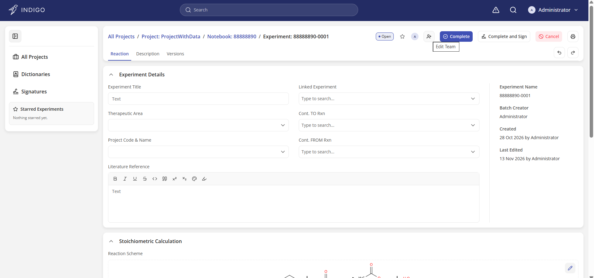
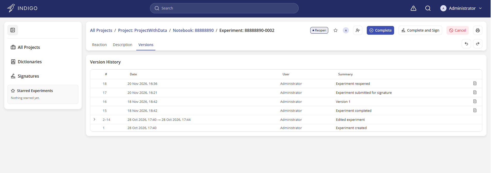
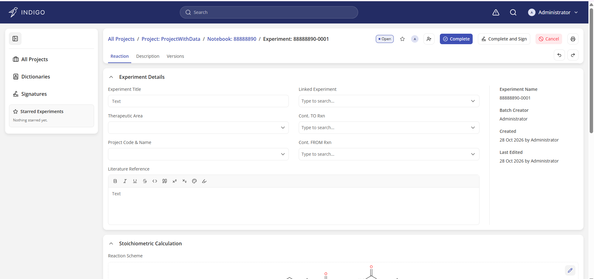
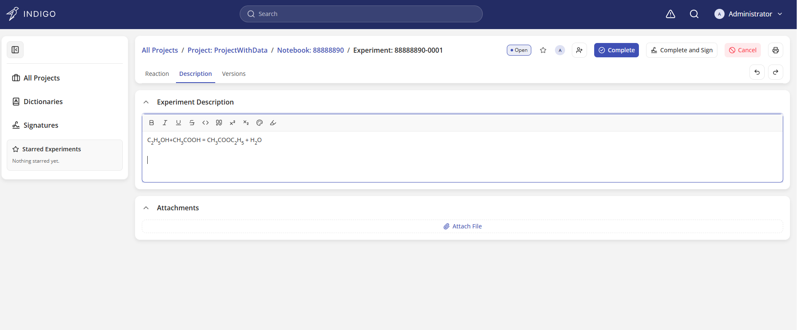

# Working in an Experiment

An Experiment page has three tabs: **Reaction**, **Description** and **Versions**. This chapter covers the page header, the **Experiment Details** section (on the **Reaction** tab) and the **Experiment Description** (on the **Description** tab). For the rest of the **Reaction** tab and other topics, see:

- [Reaction and Stoichiometry](04-reaction-and-stoichiometry.md)
- [Batches and Analytics](05-batches-and-analytics.md)
- [Attachments](06-attachments.md)

To create, complete, reopen or repeat an Experiment, see [Projects, Notebooks and Experiments](02-projects-notebooks-experiments.md).

## Before you start

- To edit, you need **Can Edit** permission or higher, and the Experiment must be **Open** or **Reopen**. In a **Completed** Experiment, or with **Can View** permission, you can read but not change anything.
- Changes are saved automatically when you leave a field. There is no Save button in these sections.

## The Experiment header

The header shows the breadcrumbs, the status, a star, and these actions:

- **Complete** - locks the finished Experiment.
- **Complete and Sign** - sends the Experiment for signing.
- **Reopen** - makes the Experiment editable again, after you confirm.
- **Cancel** - cancels the Experiment, after you confirm. It can no longer be edited.
- Print icon - creates a PDF report of the Experiment. Projects and Notebooks cannot be printed.

For how these actions change the status, see [Projects, Notebooks and Experiments](02-projects-notebooks-experiments.md).
- **Edit Team** icon - opens the team of the Experiment (see [Permissions and Team Management](07-access-and-permissions.md)).
- Undo and redo arrows - step back or forward through your edits.

### How to undo and redo changes

Use the undo and redo arrows in the header, or the keyboard:

| Action | Windows | Mac |
|---|---|---|
| Undo | Ctrl+Z | Cmd+Z |
| Redo | Ctrl+Y | Cmd+Shift+Z |

### How to review earlier versions

Open the **Versions** tab. **Version History** lists each version with its number, date, user and a summary, for example "Experiment completed", "Experiment submitted for signature" or "Experiment reopened". Edits made between these steps are grouped into one line, which you can expand.

## How to fill in the Experiment Details

The **Experiment Details** section is at the top of the **Reaction** tab. All fields are optional.

- **Experiment Title** - free text.
- **Therapeutic Area** and **Project Code & Name** - choose from the lists. The values come from Dictionaries (see [Administration](08-administration.md)).
- **Literature Reference** - rich text.
- **Linked Experiment**, **Cont. TO Rxn**, **Cont. FROM Rxn** - Experiments related to this one, or continued to or from it.
- On the right, filled in by the system: **Experiment Name**, **Batch Creator**, **Created** and **Last Edited** (with the user name). **Last Edited** updates whenever you change a field.

### How to link Experiments

This works the same way for **Linked Experiment**, **Cont. TO Rxn** and **Cont. FROM Rxn**.

1. Click into the field and type an Experiment ID.
2. Select an Experiment from the suggestions. Repeat to add more.
3. To remove a link, remove its tag (the x).

## How to write the Experiment Description

1. Open the **Description** tab.
2. Click into the **Experiment Description** field and type your text.
3. To format text, select it and use the toolbar: bold, italic, underline, subscript, superscript and more.
4. Click outside the field when you are done.

Changes, including formatting, are saved automatically. If saving fails, you see "Failed to save description. Please try again."

> Tip: Use subscript and superscript for formulas and charges, for example C₂H₅OH + CH₃COOH = CH₃COOC₂H₅ + H₂O, or Na⁺.

> Tip: You can paste text from Word or another editor. Basic formatting is kept, other styling is removed and the text stays.
