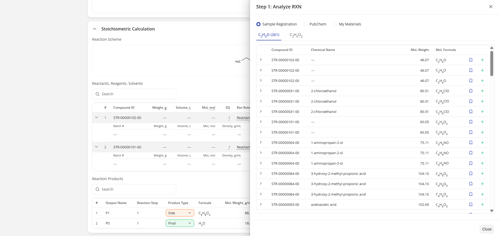
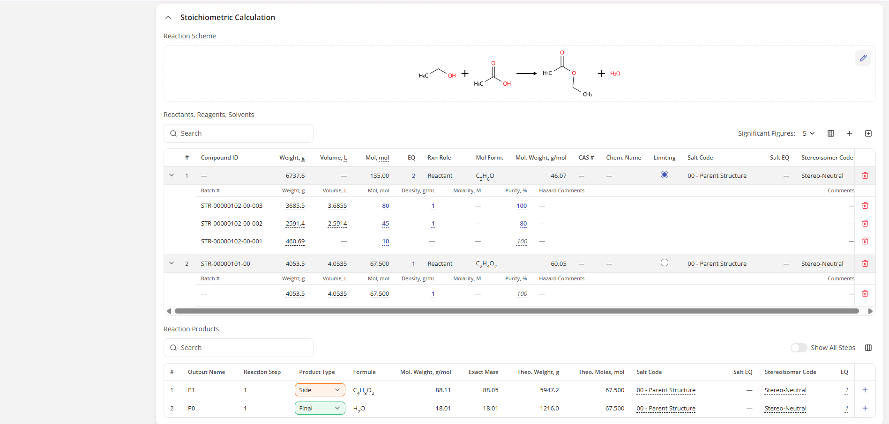
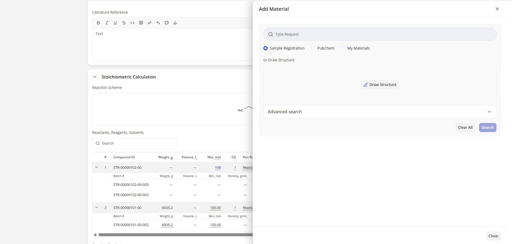

# Reaction and Stoichiometry

Every Experiment is built around a reaction. You draw the reaction scheme, then the **Stoichiometric Calculation** section lists the materials that take part in it, with their amounts. The scheme and the tables are linked: changes in one are reflected in the other.

## Before you start

- You need an open Experiment and edit access to it. See [Projects, Notebooks and Experiments](02-projects-notebooks-experiments.md).
- The section has two tables:
  - **Reactants, Reagents, Solvents** - the materials you put into the reaction.
  - **Reaction Products** - the products of your scheme, filled in automatically.
- Salt codes and stereoisomer codes are chosen from lists maintained as Dictionaries. See [Administration](08-administration.md).

---

## How to draw or edit a reaction

1. In **Stoichiometric Calculation**, click the pencil icon (**Draw Reaction**) at the top right of the **Reaction Scheme**.
2. In the **Structure Editor**, draw the reactants and products.
3. Click **Save**. Click **Cancel** to discard your changes.

The scheme is saved, the products appear in **Reaction Products**, and the **Step 1: Analyze RXN** window opens automatically (see below). When you edit an existing reaction, the tables are updated to match: rows for removed reactants disappear and new reactants get rows.

> Tip: A reaction cannot be saved if two reactants, or two products, have identical structures. Change the structures and save again.

> **Not yet available:** Adding further reaction steps.

## How to import a reaction

The structure editor is Ketcher, so import a reaction by pasting it into the editor:

1. Open the **Structure Editor** as described above.
2. Paste the reaction into the drawing area.
3. Click **Save**.

The reaction is then handled like one you drew yourself, including the **Analyze RXN** step below.

## How to match reactants to known materials

The **Step 1: Analyze RXN** window opens after you save a reaction. It helps you replace drawn structures with real materials.

1. Choose a source with the radio buttons at the top. Only one source is active at a time:
   - **Sample Registration** - samples registered in Indigo ELN.
   - **PubChem** - a public chemistry database. It is currently used as a demo source and can be replaced or extended with other systems.
   - **My Materials** - materials you saved earlier.
2. Open the tab for a reactant. Tabs are named by molecular formula, with the number of matches in brackets. Click the arrow at the start of a row to see more details.
3. Click the green **+** on the material you want to use. It is added to **Reactants, Reagents, Solvents**.
4. Click the bookmark icon to save a material to **My Materials**. Saved materials show a filled bookmark.
5. When you are done, click **Close**.

A reactant you did not match gets a blank row, with **Mol. Weight** and **Mol Form.** taken from your drawing. You can match it later.

## How to read the stoichiometry tables

**Reactants, Reagents, Solvents.** Each material has a main row and one or more sample rows beneath it (see [How to work with several samples of one material](#how-to-work-with-several-samples-of-one-material)).

- Main row: **#**, **Compound ID**, **Weight**, **Volume**, **Mol**, **EQ**, **Rxn Role**, **Mol Form.**, **Mol. Weight**, **CAS #**, **Chem. Name**, **Limiting**, **Salt Code**, **Salt EQ** and **Stereoisomer Code**.
- Sample rows: **Batch #**, **Weight**, **Volume**, **Mol**, **Density**, **Molarity**, **Purity**, **Hazard Comments** and **Comments**.

**Reaction Products.** One row per product: **Output Name** (P0, P1 and so on), **Reaction Step**, **Product Type**, **Formula**, **Mol. Weight**, **Exact Mass**, **Theo. Weight**, **Theo. Moles**, **Salt Code**, **Salt EQ**, **Stereoisomer Code** and **EQ**. **Product Type** is **Side** or **Final**. Switch on **Show All Steps** to see products of every reaction step.

Useful controls above the **Reactants, Reagents, Solvents** table:

- **Search** - filters the rows.
- **Significant Figures** - choose 1 to 5 digits shown in calculated values.
- Column icon - choose which columns are shown. Tick or untick the columns in the list.
- **+** (**Add empty row**) and the square icon with a plus (**Add sample**) - see below.

Other points:

- Unit pick lists: weight in mg, g or kg; volume in uL, mL or L; moles in umol, mmol or mol.
- **Limiting** is a radio button. Exactly one material is limiting; the first material is selected by default.
- **Rxn Role** is **Reactant**, **Catalyst**, **Reagent** or **Solvent**. New materials are **Reactant**.
- Changing a material from or to **Reactant**, or deleting a reactant, also updates the reaction scheme.

## How to add a material

- **Add empty row** - click **+** above the table. Fill in **Chem. Name**, **Mol. Weight**, amounts and **Rxn Role** yourself.
- **Add sample** - click the square icon with a plus. The **Add Material** panel slides in from the right. Type a request or draw a structure, choose a source (**Sample Registration**, **PubChem** or **My Materials**), use **Advanced search** for more filters, and click **Search**. Add the material you want with the green **+**.

> **Not yet available:** Adding a product row manually, and adding a product from the reagent catalogue.

## How to work with several samples of one material

A material can be made up of several samples, for example two batches of the same reactant. Each sample is a separate row under the material.

1. Click **Add sample** (the square icon with a plus above the table). The **Add Material** panel opens.
2. Search for the same material and select the new sample. It is added as a new sample row under the existing material.
3. Enter **Weight**, **Volume** or **Mol** for each sample. **Density**, **Molarity** and **Purity** are set per sample.
4. The material's main row shows the total of its samples and updates when you change or delete a sample.
5. To hide or show the samples, click the arrow at the start of the material row. They are expanded by default.
6. To remove a sample, click the trash icon on its row.

> Tip: **Limiting** is chosen for the whole material, not for individual samples. Editing one material's samples does not change other materials.

## What are Salt Code and Salt EQ?

A compound can be stored as a salt. **Salt Code** says which form it is and **Salt EQ** gives the equivalents of the salt part.

- **Salt Code** is chosen from a list. The default is **00 - Parent Structure** (no salt). A material taken from a database keeps the salt code stored there.
- **Salt EQ** can be edited only when a salt code other than the default is selected.
- Products have the same two columns. The salt code and equivalents of a batch are compared with these when the system matches the batch to a product (see [Batches and Analytics](05-batches-and-analytics.md)).

### How the salt changes the molecular weight

When you select a salt code and a **Salt EQ**, the system recalculates **Mol. Weight** so that it covers the parent structure plus the salt. Each salt code in the list has its own weight and electric charge: an acid such as **Hydrochloride** is neutral, an anion such as **Chloride** or **Sulfate** is negative, and a cation such as **Sodium** or **Calcium** is positive.

**Salt EQ** must be a whole number (1, 2, 3 ...) or 0.5. Any other value is rejected.

- **Whole number:** one molecule of the parent structure plus that many units of the salt, for example 1 for a mono-hydrochloride or 2 for a dihydrochloride.
- **0.5:** two molecules of the parent structure share one unit of the salt, for example a hemisulfate. The parent's weight is counted twice instead of the salt's weight being multiplied.

The system also balances the charges. The parent and the salt must cancel each other out, so hydrogen atoms are added to or removed from the parent when needed:

- With an **anion** salt code (for example **Chloride**), the parent must be positive, so one hydrogen is added for each unit of charge.
- With a **cation** salt code (for example **Sodium**), the parent must be negative, so one hydrogen is removed for each unit of charge.
- With a **neutral** salt code (for example **Hydrochloride**), or when you have already drawn the parent as an ion with the right charge, no hydrogen is added or removed.

The result is the weight of the parent (counted once, or twice for 0.5), plus or minus the hydrogens, plus the salt's weight multiplied by the number of salt units.

Examples for a parent structure with a weight of 100:

| Salt code | Salt EQ | What happens | Mol. Weight |
|---|---|---|---|
| 01 - Hydrochloride | 1 | Neutral salt: nothing added or removed. 100 + 36.46 | 136.46 |
| 09 - Chloride | 1 | Anion: 1 hydrogen added. 100 + 1.01 + 35.45 | 136.46 |
| 40 - Sodium | 1 | Cation: 1 hydrogen removed. 100 - 1.01 + 22.99 | 121.98 |
| 04 - Sulfate | 0.5 | Two parents (200), 2 hydrogens added. 200 + 2.02 + 96.07 | 298.09 |

> Tip: If you draw the parent structure already as an ion with the charge the salt needs, the system does not change any hydrogens.

## How to change a material's role or delete it

- **Role:** click the **Rxn Role** cell and choose the new role.
- **Delete:** click the trash icon on the row and confirm.

---

## See also

- [Batches and Analytics](05-batches-and-analytics.md) - product batches use the products you define here.
- [Working in an Experiment](03-working-in-an-experiment.md)
