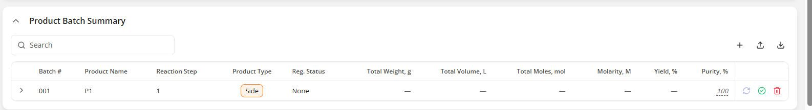
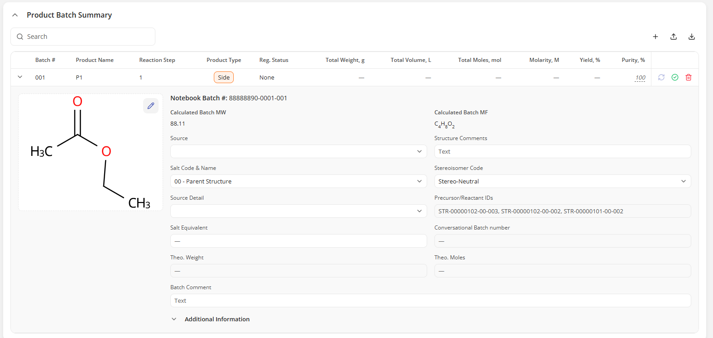

# Batches and Analytics

Once a reaction has produced material, you record it as a **Batch** in the **Product Batch Summary**. You can describe each batch in detail, import or export batches, and register them.

## Before you start

- You need an open Experiment and edit access to it. See [Projects, Notebooks and Experiments](02-projects-notebooks-experiments.md).
- Batches are compared with the products in **Reaction Products**, so draw the reaction first. See [Reaction and Stoichiometry](04-reaction-and-stoichiometry.md).
- Many batch fields are chosen from lists maintained as Dictionaries. See [Administration](08-administration.md).

---

## Batches

### How to read the Product Batch Summary

The table has one row per batch. Its columns are **Batch #**, **Product Name**, **Reaction Step**, **Product Type**, **Reg. Status**, **Total Weight**, **Total Volume**, **Total Moles**, **Molarity**, **Yield** and **Purity**.

- **Reg. Status** is **None**, **In Progress**, **Registered** or **Register Failed**.
- **Total Moles** and **Yield** are calculated by the system. You enter weight or volume, purity and molarity.
- **Product Type** shows **Side** for a batch that does not match one of your products.
- Use **Search** to filter the rows.

The toolbar above the table has **+** (add a batch), **Import SDF** and **Export SDF**. Each row has icons to sync, **Register batch** and delete.

### How to add a batch

1. In **Reaction Products**, click **+** (**Add Batch**) on the row of the product you made.
2. A row is created with the name, product type and formula filled in from that product, and a batch number is assigned automatically.

You can also click **+** in the **Product Batch Summary** toolbar. Choose whether to link the new batch to one of your products or to add an empty batch.

### How to enter batch details

1. Click the arrow at the start of the batch row to expand it.
2. Fill in the fields you need.

- The structure, **Salt Code & Name**, **Salt Equivalent** and **Stereoisomer Code** decide whether the batch matches one of your products. If they match, the name, product type and formula are filled in from the product; if not, the batch is a **Side** product.
- **Source**, **Source Detail**, **Structure Comments** and **Batch Comment** are free choices or text.
- The system fills in **Notebook Batch #**, **Calculated Batch MW**, **Calculated Batch MF**, **Precursor/Reactant IDs**, **Theo. Weight** and **Theo. Moles**. **Conversational Batch number** is also read-only.
- Click **Additional Information** for **Compound State**, **Virtual Compound ID**, **Compound Protection**, **Melting Point**, **Residual Solvents**, **Storage Instructions**, **Health Hazards**, **Solubility in Solvents**, **Handling Precautions**, **External Supplier** and **Purity Calculations**. Fields with a pencil icon open a small form.

> Tip: **Salt Equivalent** can be edited only when **Salt Code & Name** is something other than "00".

### How to add an unmatched batch to the products

Click the sync icon on the batch row. Its structure is added to the products and the reaction scheme, and matching batches are updated.

### How to import and export batches

- **Import:** click **Import SDF** and select an SDF file. Each structure becomes a new batch and is compared with your products.
- **Export:** tick one or more batches, then click **Export SDF**. A file with all available attributes is downloaded.

### How to delete batches

Click the trash icon on a batch row. Batches that are registered or sent for registration cannot be deleted, and the system tells you which ones.

### How to register a batch

Registration is available only if your Indigo ELN is connected to an external registration service.

1. Click the **Register batch** icon on the row.
2. If required information is missing, a message lists it and registration does not start. Required: **Total Weight** or **Total Volume** above zero, **Source**, **Source Detail** and **Stereoisomer Code**.
3. The batch shows **In Progress** while the service works.

The result is **Registered** (the details become read-only and a registered batch number is assigned) or **Register Failed** (correct the problem and try again).

---

## Analytics

> **Not yet available:** Analytical samples and analysis requests (the **Samples** tab of an Experiment).

---

## See also

- [Reaction and Stoichiometry](04-reaction-and-stoichiometry.md)
- [Attachments](06-attachments.md)
