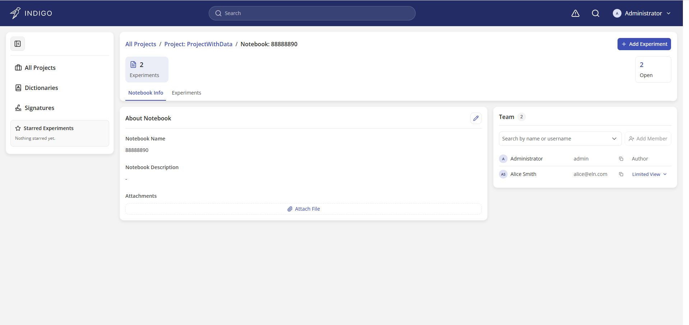
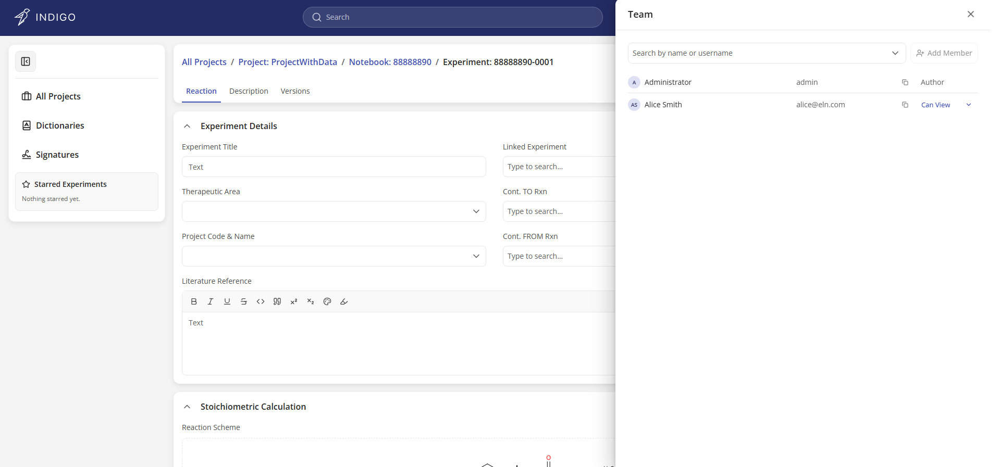
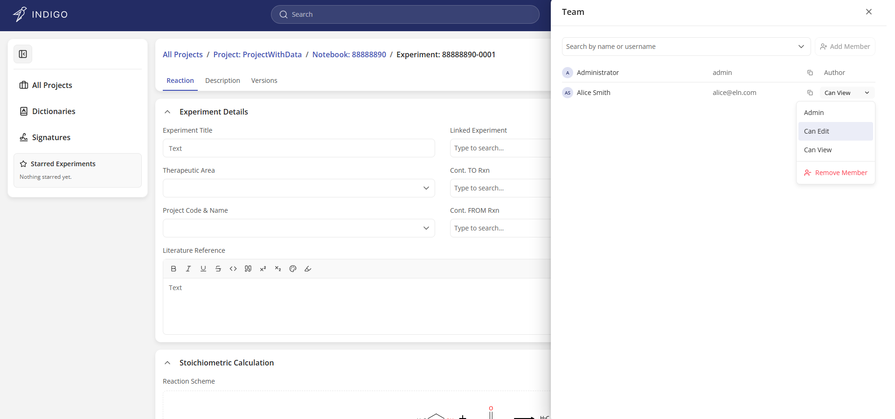

# Permissions and Team Management

Who can see and change a Project, Notebook or Experiment is decided by its **Team**: the list of people who have access, each with a permission. This chapter is the one place that explains how to manage that list. It applies to all three levels.

## Before you start

- Only members with **Admin** permission on the item can add, change or remove team members.
- On a Project or Notebook, the **Team** panel sits on the **Project Info** or **Notebook Info** tab. On an Experiment, click the **Edit Team** icon in the Experiment header. See [Projects, Notebooks and Experiments](02-projects-notebooks-experiments.md) and [Working in an Experiment](03-working-in-an-experiment.md).

## Permission levels

- **Admin**: can change the content and also manage the team (add members, change permissions, remove members).
- **Can Edit**: can change the content only, but cannot manage the team. Some actions need **Can Edit** or higher, for example deleting an attachment (see [Attachments](06-attachments.md)).
- **Can View**: read-only access. This is what a new member gets by default.
- **Author**: shown next to the person who created the item.
- **Limited View**: given automatically by the system. See the next section.

> Tip: Start with the default and raise the permission only for people who need to edit.

## Limited View

You can add someone to an Experiment without adding them to its Notebook or Project first. The system then adds them to the parent items automatically with **Limited View**.

A person with **Limited View** on a Notebook sees only the Experiments they were added to. They do not see anything else in that Notebook. This lets people open the Experiments they work on without having to be added to every parent item.

For example, Alice is added to one Experiment only. In the Notebook's **Team** panel she appears as **Limited View**, and in the Notebook she sees just that Experiment.

You can change the permission of a **Limited View** member like any other member (see below). You do not set **Limited View** yourself when adding a member. To give the person full access to the Notebook, add them to the Notebook directly (see below).

## How to view team members

1. Open the **Team** panel of the Project, Notebook or Experiment.

For each member you see the name, the user name or email, and the permission. Click the copy icon to copy the member's email address.

## How to add a team member

1. In the **Team** panel, click the field **Search by name or username**.
2. Type part of a name or user name, then select the person from the list.
3. Check the permission. It is **Can View** by default. Change it if needed.
4. Click **Add Member**.

The member appears in the team list.

## How to change a member's permission

1. In the **Team** panel, click the permission shown next to the member.
2. Choose **Admin**, **Can Edit** or **Can View**.

The change applies to this item and everything below it.

## How to remove a team member

1. In the **Team** panel, click the permission next to the member and choose **Remove Member** (the last item in the list).
2. Confirm in the message "Are you sure you want to remove the member?" Click **Cancel** to keep the member.

On a Project, if the person was also added directly to a Notebook or Experiment, the window has a checkbox, unchecked by default: "Also remove this team member from all Notebooks and Experiments in this Project." Tick it to remove them from those too.

## How access is passed between levels

- Someone added to a **Project** is added to every Notebook and Experiment in it, with the same permission. On those lower items they are marked **(Inherited)**.
- Someone added to a **Notebook** is added to every Experiment in it with the same permission, marked **(Inherited)** there.
- Someone added to a lower-level item without being a member of its parents gets **Limited View** on those parents.
- Changing a permission on a Project or Notebook changes it for everything below.

The **(Inherited)** mark is only a hint. It tells you why a member appears on an item you did not add them to. You can change the permission of an inherited member, or remove them, like any other member.

> Tip: Add people at the highest level where they need full access. You then don't have to add them again to each Notebook and Experiment.
